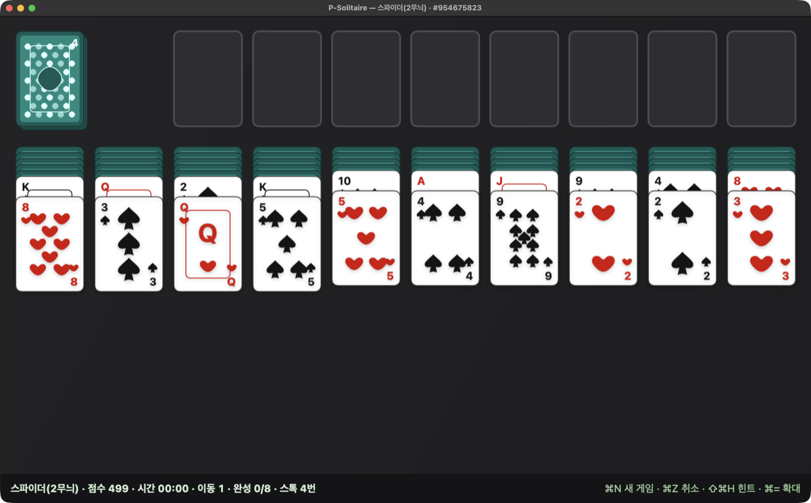
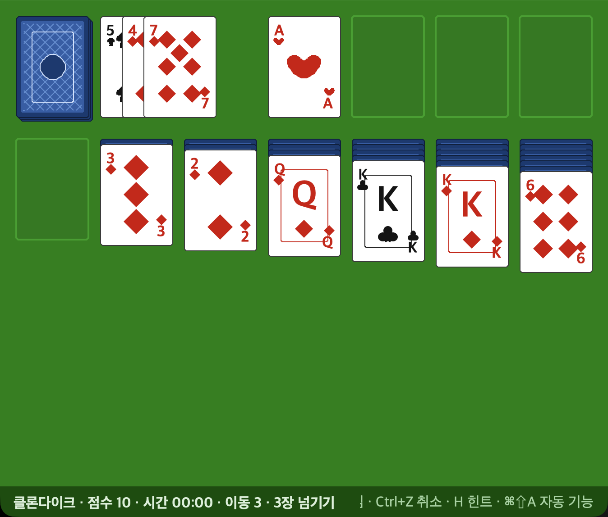
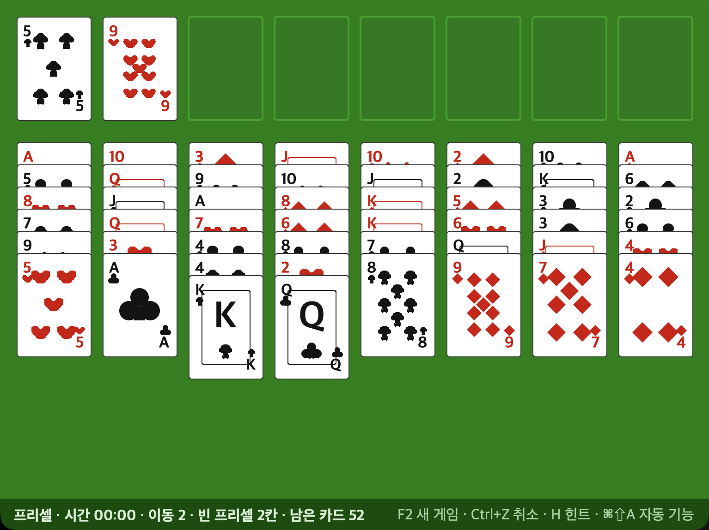
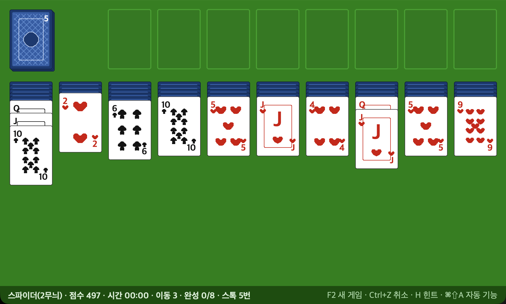
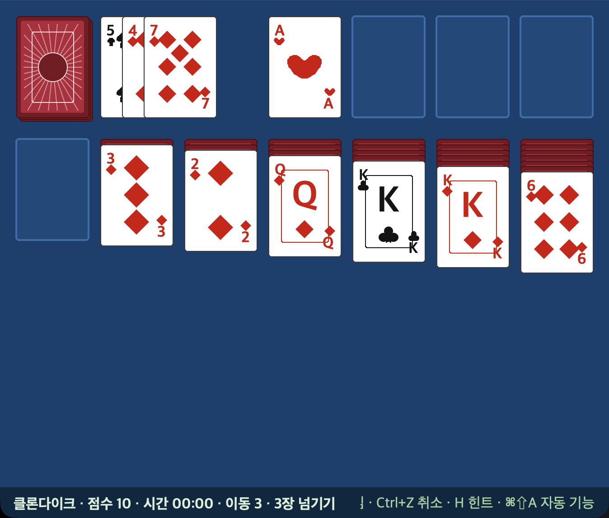
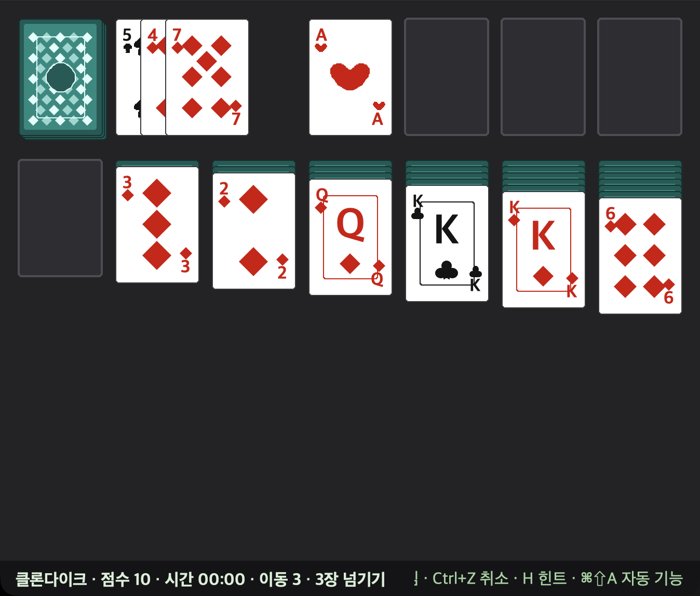

# P-Solitaire — 마이크로소프트 클래식 솔리테어 3종

> **현재 활성 트랙은 Swift 네이티브(`native/`)입니다.** 2026-10-27 **v0.5.1(빌드 7)** 설치 · `swift test` **56/56** · `--selftest` **163/163** · `--shots` **46장**.
> 파이썬 판은 **v0.2.6(빌드 26)** 으로 동결했고 소스는 `archive/python/`에 있습니다. 파이썬 설치 번들은 현재 `~/.Trash/P-Solitaire.app`에 보존되어 있고, 이번 작업에서 수정·이동하지 않았습니다(네이티브와 같은 번들 이름/ID이므로 복원·동시 실행 금지).
> 아래 **`## 동결된 파이썬 판 (기록)`** 부터는 동결 시점의 기록입니다. 현재 기능·빌드는 **Swift 네이티브** 절을 보세요.

## Swift 네이티브 (현재)



**클론다이크 · 프리셀 · 스파이더**를 SwiftUI + Canvas로 다시 만든 macOS 앱입니다. 외부 런타임·네트워크 의존이 없고, 설정·전적은 파이썬과 분리된 `~/.psolitaire-nat.json`에 저장합니다.

### 설치·빌드

```sh
cd native
./build_native.sh test       # swift test + 화면 자체 검사(창 없이)
./build_native.sh shots      # 게임 3종 × 테마 9조합 + 전체 창 + 150% + 전적 PNG 46장
./build_native.sh package    # 릴리스 빌드 → ~/Applications/P-Solitaire.app
./build_native.sh run        # 설치본 실행(창이 뜬다 — 사용자 확인 뒤에만)
```

- 설치본: `~/Applications/P-Solitaire.app` · 번들 ID `com.borasarang.P-Solitaire` · 실행 파일 `P-Solitaire` · macOS 14+
- 데이터: `~/.psolitaire-nat.json` (진행 중인 판 스냅숏·설정·전적) · 로그: `~/Library/Logs/P-Solitaire.log`
- 파이썬 앱/데이터(`~/.Trash/P-Solitaire.app`, `~/.solitaire_python_stats.json`)는 건드리지 않습니다. 파이썬 번들을 복원하면 번들 ID가 겹치므로 네이티브와 동시에 실행하지 마세요.
- 이전 네이티브 **v0.4.2 `P-Solitaire Native.app`**는 Applications에서 제거해 `~/.Trash/P-Solitaire Native (v0.4.2 235240).app`에 보관했습니다. 현재는 새 `P-Solitaire.app`만 Applications에 있습니다.

### 주요 기능

- **확대**: 100·125·150·175·200% · `⌘=`/`⌘-`/`⌘0` · 배율 저장 · 화면에 들어가는 배율로 자동 제한. 그리기·판정은 1x 논리 좌표, 화면에 낼 때만 배율 적용
- **이어하기**: 이동·되돌리기·리두·설정 변경 때 진행 중인 판을 자동 저장하고 다음 실행 때 복원. `played`는 **첫 실제 이동 때만** 집계
- **리두**: `⇧⌘Z` · 편집 메뉴 실행 취소/복귀 연결 · 새 이동 시 redo 무효화
- **설정 `⌘,`**: 테마·확대·효과음·애니메이션·클론다이크 1/3장·스파이더 난이도/묶음/풀리는 판·자동 기능·전적 초기화
- **스파이더 풀리는 판만**: 새 스파이더 판을 **1·2·4무늬 모두 반드시 풀리는 배분**으로 낸다(기본 켬). 1무늬 판을 풀어 해답을 얻고 함께 움직인 카드가 같은 무늬가 되도록 다시 칠한 뒤, 실제 규칙으로 해답을 다시 두어 이김을 확인하고 내보낸다. 만드는 동안은 "풀리는 판을 만드는 중…" 안내로 입력을 막고, 판 번호·다시 시작·이어하기에서도 같은 배분이 유지된다
- **전적 `⌘T`**: 게임별 판/승/승률/최고 시간/최고 점수를 **오른쪽 정렬 표**로 표시, 현재 게임 배지, 총계 요약, 초기화
- **시드**: 판 번호 복사, `⇧⌘O` 번호로 새 게임, 정보/상태줄 표시
- **대화상자**: 새 게임/다시 시작/게임 전환 확인 · 우승(카드 쏟아지기/새 게임) · 둘 수 있는 수 없음 안내
- **조작감**: 웨이스트 팬 아무 카드나 클릭 · 드래그 그림자/열린 손 커서/햅틱 · 직접 끌면 즉시 이동(자동 이동에만 비행 연출)
- **카드 그림자**: 그림자는 카드 전체 실루엣에만 적용. 카드 안의 하트 핍 하나하나에 그림자가 생겨 테두리처럼 보이던 문제를 v0.5.0에서 수정
- **소리·접근성**: 이동/스톡/뒤집기/우승 시스템 사운드, VoiceOver label/value/hint, 상태줄 고정폭 숫자
- **메뉴**: 앱 메뉴(`게임`)와 설정/전적/대화상자는 한국어. macOS 표준 메뉴(편집·보기·창·도움말)는 시스템 언어를 따릅니다.

### 단축키

| 키 | 동작 |
|---|---|
| `⌘N` / `⌘R` | 새 게임 / 같은 판 다시 시작(진행 중이면 확인) |
| `⌘Z` / `⇧⌘Z` | 실행 취소 / 리두 |
| `⇧⌘H` / `⌥⌘A` | 힌트 / 자동 완성 |
| `⌘1` `⌘2` `⌘3` | 클론다이크 · 프리셀 · 스파이더 |
| `⌘=` / `⌘-` / `⌘0` | 확대 / 축소 / 100% |
| `⌘,` / `⌘T` | 설정 / 전적 |
| `⇧⌘O` / `⇧⌘A` | 판 번호로 새 게임 / 자동 기능 모두 |
| `Space` / `H` / `A` / `D` | 스톡 · 힌트 · 자동 완성 · 1/3장(로컬 별칭) |
| `?` / `F1` | 도움말 |

## 동결된 파이썬 판 (기록)

> 아래 `### 실행`부터 `## 로그·오류`까지는 **파이썬 v0.2.6 동결 시점**의 기록입니다. 지금은 수정하지 않습니다. 설치 경로는 당시 기준이며, 현재 번들은 `~/.Trash/P-Solitaire.app`에 있습니다.
>
> **실행 금지**: 아래 `build_and_run.sh package/app` 명령을 지금 실행하면 **현재 네이티브 `~/Applications/P-Solitaire.app`(v0.5.0)를 파이썬 번들로 덮어쓴다.** 파이썬은 기록으로만 보관한다. `run.sh`/테스트만 참고할 수 있다.

클래식 MS 솔리테어를 **Python 표준 라이브러리만**으로 다시 만든 게임입니다.
**클론다이크 · 프리셀 · 스파이더**를 골라서 플레이할 수 있고,
카드 그림은 이미지 파일 없이 캔버스 도형으로 직접 그립니다.

| 클론다이크 | 프리셀 | 스파이더 |
|---|---|---|
|  |  |  |

배경 3종 · 카드 뒷면 3종을 메뉴 **보기**에서 골라 바꿀 수 있습니다(예: 파란 탁자 + 붉은 햇살).

| 파란 탁자 + 붉은 햇살 | 어두운 탁자 + 청록 물방울 |
|---|---|
|  |  |

### 실행 (파이썬, 동결)

> 아래 명령은 **동결된 파이썬 판** 기준입니다. 소스가 `archive/python/`으로 이동했으므로 먼저 `cd archive/python`을 실행하세요. 네이티브는 `cd native && ./build_native.sh run`.

```sh
./run.sh                      # tkinter가 있는 파이썬을 찾아 실행(마지막 게임으로 시작)
python3 solitaire.py          # 직접 실행
python3 solitaire.py --game freecell     # 게임을 골라 시작
SOLITAIRE_GAME=spider ./run.sh           # 환경 변수로도 고를 수 있음
```

홈 응용 프로그램 폴더에 앱을 만들고 실행하려면:

```sh
# 실행 금지(현재 네이티브 앱을 덮어쓴다) — 동결 당시 명령 기록:
# ./build_and_run.sh package game  # ~/Applications/P-Solitaire.app 생성(아이콘·서명 포함)
# ./build_and_run.sh app game      # 위 과정 + 바로 실행
# open ~/Applications/P-Solitaire.app
# 테스트만 허용: ./build_and_run.sh test game unit
```

- 번들 안에는 실행기(`Contents/MacOS/P-Solitaire`) + 파이썬 스텁 + 소스가 함께 들어가고, **메뉴 막대와 창 제목이 "P-Solitaire"** 로 나옵니다(스텁을 못 찾으면 시스템 파이썬으로 폴백).
- 로그는 `~/Library/Logs/P-Solitaire.log` 에 남습니다(실행기 경로·시작한 게임·오류).

- **요구사항**: Python 3.9+ 와 tkinter(**Tk 8.6 이상**).
  Homebrew 기본 `python3` 에는 tkinter가 없습니다. 없으면 `run.sh` 가 설치 방법을 알려 줍니다.
- 애플 기본 파이썬(`/usr/bin/python3`, Tk 8.5)은 macOS 15+ 에서 창 내용을 그리지 못하므로 쓰지 마세요.

## 게임 고르기

- 메뉴 **게임 → 클론다이크 / 프리셀 / 스파이더** 또는 **`Cmd+1` · `Cmd+2` · `Cmd+3`**
- **스파이더 난이도**: 메뉴 **게임 → 스파이더 난이도**(1무늬 쉬움 · 2무늬 보통 · 4무늬 어려움) — 기본 1무늬
- **스파이더 묶음 이동**: 메뉴 **게임 → 스파이더 묶음 이동**
  - `같은 무늬만 (MS 규칙)` — **기본값**. 실제 MS와 같은 규칙(무늬가 섞인 묶음은 통째로 옮길 수 없다 — 맨 위 카드만 한 장씩)
  - `무늬 상관없이 (쉬움)` — 무늬가 섞여도 내림차순이면 통째로 옮겨집니다(난이도가 낮아짐)
  - 바꿔도 **진행 중인 판·점수는 그대로**이고 이동 규칙만 바뀝니다.
- 마지막에 하던 게임과 난이도는 자동으로 기억됩니다(`~/.solitaire_python_stats.json`).
  게임을 바꾸면 진행 중이던 판은 버리고 새 판을 시작합니다.

## 조작

| 마우스 | 동작 |
|---|---|
| 스톡(왼쪽 위) 클릭 | 클론다이크: 카드를 1장/3장 넘깁니다 · 스파이더: 열마다 한 장씩 10장을 돌립니다 |
| 카드 끌어놓기 | 놓을 수 있는 자리는 노란 테두리로 표시됩니다(프리셀은 여러 장 묶음도 가능) |
| 더블클릭 | 클론다이크: 파운데이션에 올릴 수 있으면 자동으로 올립니다 · 프리셀: 파운데이션 → 태블로 → 빈 프리셀 순 · 스파이더: 같은 무늬로 잇거나 카드를 드러내는 자리로 |
| 뒤집힌 카드 클릭 | 맨 위 카드를 공개합니다(+5점, 클론다이크) |
| 묶음(여러 장) 잡기 | **옮기려는 묶음의 맨 위 카드**(겹쳐진 위쪽 띠)부터 **그 열의 맨 위 카드까지** 규칙이 이어질 때만 집힙니다(클론다이크·프리셀은 색이 번갈아, 스파이더는 같은 무늬). 집은 즉시 상태줄에 `묶음 N장`, 집히지 않으면 그 이유(예: `위에 덮인 카드부터 옮겨야 합니다` · `무늬가 다르면 한 묶음으로 못 옮깁니다`)를 4초 보여 줍니다. |

| 키 | 동작 |
|---|---|
| `F2` / `N` | 새 게임 |
| `R` | 같은 판 다시 시작(같은 시드) |
| `Ctrl+Z` | 실행 취소 |
| `Space` | 카드 넘기기 / 스파이더 스톡 돌리기 |
| `H` | 힌트 |
| `A` | 자동 완성(클론다이크·프리셀, 조건이 맞을 때) |
| `D` | 1장/3장 넘기기 전환(클론다이크) |
| `Cmd+1` `Cmd+2` `Cmd+3` | 클론다이크 · 프리셀 · 스파이더 전환 |
| `Cmd+Shift+A` | 자동 기능 모두 켜기/끄기 |
| `Cmd+=` / `Cmd+-` | 확대 / 축소(100·125·150·175·200%) |
| `Cmd+0` | 100%로 되돌리기 |
| `F1` | 도움말(게임별 규칙) |
| `Cmd+Shift+D` | 디버그 패널(성능·로그·오류 수) |
| `Esc` | 우승 연출 중단 |

## 자동 기능 (켜기/끄기)

메뉴 **게임 → 자동 기능**에서 하나씩 또는 **모두 켜기/끄기(`Cmd+Shift+A`)** 로 바꿀 수 있습니다.
고른 상태는 저장되어 다음 실행에도 그대로입니다.
기본값은 더블클릭 자동 이동·이동 뒤 자동 올리기 **켜짐**, 게임 끝나면 자동 완성 **꺼짐**입니다(우승 직후 스스로 정리하게 하려면 직접 켜세요).

| 자동 기능 | 켜면 |
|---|---|
| 더블클릭 자동 이동 | 더블클릭하면 갈 곳을 찾아 옮깁니다(끄면 안 움직임). |
| 이동 뒤 파운데이션 자동 올리기 | 내가 한 번 옮긴 뒤 올릴 수 있는 카드는 저절로 올라갑니다. |
| 게임 끝나면 자동 완성 | 남은 카드를 모두 올릴 수 있게 되면 스스로 정리합니다. |

## 테마 (배경 · 카드 뒷면)

메뉴 **보기 → 배경 / 카드 뒷면**에서 각각 3종 중에 고를 수 있습니다(서로 독립적, 선택은 저장됨).

- 배경: 클래식 초록 · 파란 탁자 · 어두운 탁자
- 카드 뒷면: 푸른 격자 · 붉은 햇살 · 청록 물방울

## 확대 (배율)

메뉴 **보기 → 확대** 또는 **`Cmd+=` / `Cmd+-`** 로 100·125·150·175·200% 중에서 고릅니다(`Cmd+0` = 100%).
카드·글자·선 두께가 함께 커지고 창도 그만큼 커집니다. 고른 배율은 저장되어 다음 실행에도 그대로입니다.

- 창이 **화면보다 커지는 배율은 쓸 수 없습니다**(작은 화면에서 200% 등). 고르면 상태줄에 이유가 나오고 배율은 그대로입니다.
- 게임을 바꿔 창이 더 넓어지면(예: 클론다이크 150% → 스파이더) 화면에 들어가는 배율로 **자동으로 줄이고** 상태줄에 알립니다.
  저장된 배율은 그대로라, 다시 좁은 게임으로 돌아오면 원래 배율로 돌아갑니다.
- 그리기는 항상 1x 좌표로 하고 화면에 낼 때만 배율을 곱하므로 규칙·좌표 계산은 배율과 무관합니다.


## 규칙 요약

### 클론다이크 (7열 · 1벌 52장)
- 태블로: **색을 번갈아**(빨강↔검정), 숫자는 내림차순. 빈 줄에는 K만.
- 파운데이션: 무늬별 A→K. 스톡/웨이스트로 카드를 넘깁니다(재활용 시 −100점, 3장 모드).

### 프리셀 (8열 · 1벌 52장 · 스톡 없음)
- 카드 52장이 처음부터 모두 앞면입니다. 왼쪽 위 **프리셀 4칸**에 카드를 한 장씩 잠시 둘 수 있습니다.
- 태블로: 색을 번갈아 내림차순. 빈 열에는 아무 카드나. 파운데이션도 다시 꺼낼 수 있습니다.
- **여러 장 옮기기**: `(빈 프리셀+1) × 2^(다른 빈 열 수)` 장까지 한 번에 옮길 수 있습니다(예: 프리셀 4칸이 비고 빈 열이 없으면 5장).

### 스파이더 (10열 · 2벌 104장)
- 같은 무늬 **K→A 13장**을 모아 **8세트**를 완성하면 이깁니다. 모인 세트는 저절로 빠집니다(+100점).
- 태블로는 숫자만 내림차순이면 되고 무늬는 상관없지만, **묶음으로 옮기려면 같은 무늬**여야 합니다(MS 규칙).
  (잡은 카드부터 **그 열의 맨 위까지** 같은 무늬로 이어질 때만 한 묶음이 됩니다 — 중간에 끊기면 그 카드는 **집히지 않고**, 화면이 상태줄에 그 이유를 알려 줍니다. 위에 덮인 카드도 마찬가지로 먼저 옮겨야 합니다.)
  메뉴 **게임 → 스파이더 묶음 이동 → `무늬 상관없이 (쉬움)`** 으로 바꾸면 무늬가 섞여도 통째로 옮길 수 있습니다.
- 스톡을 누르면 열마다 한 장씩 10장을 돌립니다(**빈 열이 있으면 돌릴 수 없습니다**).
- 난이도: 1무늬(쉬움, ♠8벌) · 2무늬(보통, 각 4벌) · 4무늬(어려움, 각 2벌)

## 점수

| 게임 | 점수 |
|---|---|
| 클론다이크 | 웨이스트→태블로 +5 · 웨이스트/태블로→파운데이션 +10 · 공개 +5 · 파운데이션→태블로 −15 · 재활용 −100(3장 모드) · 태블로→태블로 0 |
| 스파이더 | 500점에서 시작 · 이동 −1 · 세트 완성 +100 |
| 프리셀 | 점수 없음(이동 횟수·시간으로 겨룸) |
| 우승 보너스(공통) | 700,000 ÷ 걸린 시간(초) — 빠를수록 높음 |

## 파일 구성

| 파일 | 설명 |
|---|---|
| `solitaire_core.py` | 게임 규칙·상태 3종(`BaseGame`·`Klondike`·`FreeCell`·`Spider`) + `make_game()` — 화면과 무관, 헤드리스 테스트 가능 |
| `solitaire.py` | tkinter 화면(그리기·입력·애니메이션·디버그 패널, 게임별 배치 자동) |
| `debuglog.py` | 로거(DebugLogger 규약: `[INFO]`/`[PERF]`/`[CACHE]`/`[ERROR]`) |
| `error_message_ko.json` | 오류 코드 → 사용자 문구 |
| `test_core.py` | 코어 테스트 51개(세 게임 규칙·묶음 규칙 옵션·덮인 카드 못 집기) |
| `test_ui.py` | UI 테스트 94개(창을 숨긴 채 이벤트 주입·게임 전환·테마·자동 기능·스파이더 묶음 규칙·덮인 카드·확대 배율·메뉴/단축키 포함) |
| `build_and_run.sh` | 빌드·테스트·실행·앱 번들 디스패처(스텁 복사 `cmd_stub()` 포함) |
| `run.sh` | tkinter 있는 파이썬 자동 선택 실행 |
| `templates/`, `tools/make_icon.py` | `.app` 번들 틀(`Info.plist`·`app-launcher.sh` 실행기)과 아이콘 생성 |
| `tools/bundle_name.py` | 실행 중 프로세스가 보는 `CFBundleName`·`CFBundleIdentifier` 확인(앱 이름 검증) |
| `docs/` | PLAN·TODO·DESIGN·CHANGELOG·API·이미지 |

## 빌드·테스트

```sh
./build_and_run.sh build game          # py_compile 검사
./build_and_run.sh test game smoke     # 코어 테스트만(빠름)
./build_and_run.sh test game unit      # 코어 + UI 테스트
./build_and_run.sh debug game          # 검사 + 테스트 + 실행
# 실행 금지: ./build_and_run.sh package game  # 현재 네이티브 앱을 덮어쓴다
```
UI 테스트는 창을 띄우지 않습니다(`root.withdraw()` + 이벤트 주입) — 사용자가 맥을 쓰는 중에도 돌릴 수 있습니다.

## 개발용 확인 모드(환경변수)

| 변수 | 설명 |
|---|---|
| `SOLITAIRE_GAME=klondike\|freecell\|spider` | 시작할 게임 |
| `SOLITAIRE_DEMO=1` / `=long` | 데모 판(게임마다 다른 상태 / 클론다이크는 가장 긴 열) |
| `SOLITAIRE_HOLD=초` | 창을 띄운 채 지정 시간 뒤 종료(수동 확인용) |
| `SOLITAIRE_BG=green\|blue\|dark` | 배경 테마(저장하지 않음) |
| `SOLITAIRE_BACK=lattice\|rays\|dots` | 카드 뒷면 테마(저장하지 않음) |
| `SOLITAIRE_ZOOM=100\|125\|150\|175\|200` | 시작 배율(저장하지 않음) |
| `SOLITAIRE_POS=x,y` | 창 위치 지정(캡처용) |
| `SOLITAIRE_HEADLESS=1` | 창을 띄우지 않음(PostScript 내보내기용) |
| `SOLITAIRE_SHOT=경로` | 창을 앞으로 올려 창 영역을 캡처하고 종료 |
| `SOLITAIRE_PS=경로` | 캔버스를 PostScript로 내보내고 종료 |

## 로그·오류

- 로그는 표준 오류로 한 줄씩 나오고, `~/Library/Logs/P-Solitaire.log` 에도 남습니다(앱 번들 실행 시).
- 디버그 패널(`Cmd+Shift+D`)에서 최근 12줄과 다시 그리기 시간·메모리·오류 수를 볼 수 있습니다.
- 오류는 `E-GAME-…` 코드로 남기고 상태바에 사용자 문구를 잠깐 보여 줍니다(`error_message_ko.json`).

## 문서

- `docs/README.md`(문서 지도) · `docs/plans/PLAN_v0.1_game.md`(1차) · `PLAN_v0.2_game.md`(게임 3종) · `PLAN_v0.2.1_game.md`(버그 2건·자동 기능·테마) · `PLAN_v0.2.3_game.md`(앱 이름·스파이더 묶음 규칙) · `PLAN_v0.2.4_game.md`(안내 문구 조기 소멸·검사 흔들림) · `PLAN_v0.2.5_game.md`(덮인 카드 집기 금지) · `PLAN_v0.2.6_game.md`(확대 배율) · `PLAN_v0.3_native_game.md`(Swift 네이티브 재작성) · `NATIVE_REVIEW_2026-10-20.md`(P0~P2 점검/구현 결과)
- `docs/TODO.md`(남은 일) · `docs/DESIGN.md`(디자인 토큰·배치) · `docs/CHANGELOG.md`(변경 기록) · `docs/api/README.md`(내부 모듈)
- 화면 캡처는 `docs/images/`(현재 판) · `docs/images/archive/`(옛 판)
- 프로젝트 규칙: `AGENTS.local.md`
