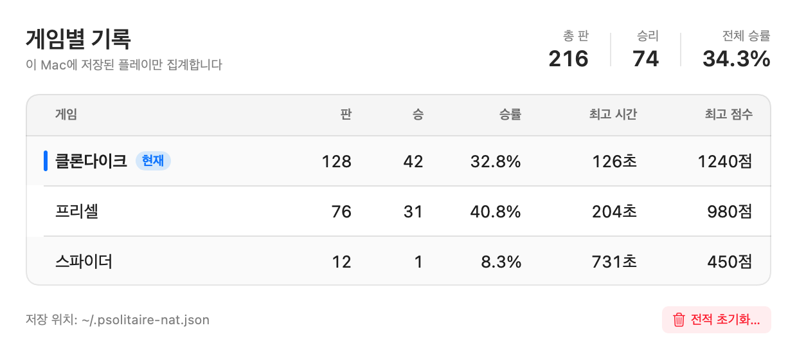

# NATIVE_REVIEW_2026-10-20 — 맥 네이티브 앱 점검과 개선 제안

> **대상(점검 시점)**: `native/` Swift 네이티브 **v0.3.1 (빌드 2)** — `~/Applications/P-Solitaire Native.app`
> **전제**: 파이썬 판은 **v0.2.6 (빌드 26)** 으로 동결·`archive/python/` 보관. 이후 개발은 네이티브만.
> **방법**: 소스 정독 + `swift test` 51/51 + `--selftest` 85/85 + 오프스크린 PNG 27장 + 실제 창 캡처 + 메뉴 구조 확인
> **상태**: 점검 시점 기록. 아래 P0~P2는 **2026-10-20 v0.4.0에서 구현·검증·패키징 완료**(§8). 전적 창 정렬은 **v0.4.1**(§9), 직접 드래그 애니메이션은 **v0.4.2**(§10)에서 다시 잡았다.


---

## 0. 한 줄 결론

게임 규칙·3종 게임·테마·자동 기능·힌트·우승 연출은 이미 파이썬 판과 동등한 수준이고 테스트도 탄탄하다.
지금 부족한 것은 **"매일 쓰는 Mac 앱"으로서의 마감**이다 — 특히 **확대(줌)**, **메뉴/단축키**, **진행 중인 판 보호**, **디버그 패널 버그**, **카드 그림/창 크롬**이 눈에 띈다.

권장 순서: **P0(줌·메뉴·데이터 보호·버그) → P1(설정/전적 창·이어하기·리두) → P2(미관·접근성·연출)**.

---

## 1. 지금 확인된 상태

| 항목 | 상태 | 근거 |
|---|---|---|
| 게임 3종 | 클론다이크·프리셀·스파이더(1/2/4무늬) | `PSolitaireKit` |
| 규칙 테스트 | **51/51** | `swift test` |
| 화면 자체 검사 | **85/85** | `--selftest` |
| 오프스크린 렌더 | **27장** (3게임 × 3배경 × 3뒷면) | `native/shots/` |
| 실제 창 | 953×602(스파이더), 상태줄 포함 | 위 캡처 |
| 성능(기존 실측) | 다시 그리기 4.1~12.3ms · 메모리 ≈118MB | `docs/TODO.md` |
| 설정·전적 | `~/.psolitaire-nat.json` (파이썬과 분리) | `GameController.swift` |
| 확대(줌) | **없음** — 파이썬 v0.2.6에만 있음 | `Theme.swift` 고정 상수 |
| 창 크기 | **고정** (`.windowResizability(.contentSize)`) | `PSolitaireApp.swift:22` |
| 메뉴 구조 | **"보기" 메뉴가 두 개** | System Events 확인 |

실제 메뉴 막대(2026-10-20, System Events):

```
Apple · P-Solitaire Native · 편집 · 보기 · 게임 · 보기 · 윈도우 · 도움말
```

---

## 2. P0 — 먼저 고칠 것 (네이티브를 주력으로 부르기 전)

### P0-1. 확대(줌)가 없다 — 파이썬에 있던 유일한 기능 후퇴

- 파이썬 v0.2.6은 **100·125·150·175·200%**, `Cmd+=`/`Cmd+-`/`Cmd+0`, 배율 저장, 화면 초과 시 자동 축소까지 지원한다.
- 네이티브는 카드 80×112, 창 674/767/953×574로 **고정**이다. 큰 모니터에서 카드가 작고, 작은 화면에서는 키울 방법이 없다.
- 제안(파이썬과 같은 5단계):
  - `settings["zoom"]` 추가, 보기 메뉴에 **확대** 하위 메뉴(100~200%, 체크 표시), `Cmd+=`/`Cmd+-`/`Cmd+0`.
  - 그리기·히트테스트·드래그는 **항상 1x 논리 좌표**로 두고, 화면에 낼 때만 배율을 적용한다.
    SwiftUI에서는 전체 콘텐츠를 `.scaleEffect(zoom, anchor: .topLeading)` + 바깥 프레임 `× zoom`으로 감싸는 방식이 가장 작다.
    (제스처 좌표가 스케일 전 로컬 좌표로 들어오는지 셀프테스트로 확인하고, 아니면 입력 좌표를 배율로 나눈다)
  - `NSScreen.visibleFrame`(메뉴 막대·독 제외)으로 화면에 들어가는 배율만 허용하고, 거절 시 상태줄에 이유 표시.
  - 배율 변경 시 진행 중 드래그 취소, 상태줄·창 크기 동시 변경, 마지막 배율 저장.
  - 게임 전환으로 창이 넓어질 때 자동 축소(파이썬과 동일).
- 검증: `--selftest`에 배율·화면 클램프·저장/복원 추가, 175%/200% PNG 렌더, 실제 창 캡처.
- 예상 규모: **M** (레이아웃은 그대로, 렌더 경계만 배율).

### P0-2. 메뉴·단축키가 Mac 앱답지 않다

확인된 문제:

1. **"보기" 메뉴가 두 개** — 시스템 View 메뉴 + `CommandMenu("보기")`가 충돌. 테마 항목은 시스템 View 쪽으로 합치거나(`CommandGroup(after: .toolbar)`), 최소한 메뉴 이름을 **"테마"** 로 바꾼다.
2. **실행 취소가 두 곳** — `편집 → 실행 취소/실행 복귀`와 `게임 → 실행 취소`가 중복. `편집`의 실행 취소는 게임 상태와 연결되어 있지 않을 가능성이 크다.
   → `CommandGroup(replacing: .undoRedo)`로 **편집 메뉴의 Undo/Redo를 게임에 연결**하고, 게임 메뉴의 중복 항목은 제거.
3. **새 게임/다시 시작/힌트/자동 완성에 메뉴 단축키가 없다** — 현재 F2·R·H·A는 로컬 키 모니터로만 동작해 메뉴에 보이지 않는다. Mac에서는 F2/F1에 `Fn`이 필요해 사실상 숨은 기능이다.
   → `⌘N` 새 게임, `⇧⌘N`(또는 `⌘R`) 같은 판 다시 시작, `⇧⌘H` 힌트, `⇧⌘A` 자동 기능(이미 있음), `⌘,` 설정.
4. **상태에 따른 비활성화가 없다** — 되돌릴 것이 없어도 실행 취소가 켜져 있고, 우승 연출 중에도 힌트/자동 완성이 눌린다.
   → `.disabled(!controller.game.canUndo)`, `.disabled(controller.busy)` 등.
5. **스파이더 난이도 메뉴가 클론다이크에서도 활성** — 누르면 `setSpiderSuits`가 **스파이더로 게임을 바꿔 버린다**. 진행 중인 판이 말없이 사라진다.
   → `.disabled(controller.variant != .spider)` 또는 "스파이더로 전환" 확인.
6. **윈도우 탭 메뉴** — `WindowGroup` 때문에 "탭 막대 보기/모든 탭 보기/이전 탭"이 노출된다. 한 창 게임에는 불필요.
   → `Window` scene 사용 또는 `NSWindow.allowsAutomaticWindowTabbing = false`.
7. **기본 Help 항목** — "Apple에 P-Solitaire Native 피드백 보내기"가 그대로 남아 있다. 앱 자체 도움말로 바꾸거나 제거.
8. **About 중복** — 앱 메뉴의 기본 "P-Solitaire Native에 관하여"와 도움말의 "정보"가 중복. 앱 메뉴 쪽을 커스텀 정보 패널로 바꾸는 편이 Mac답다.
9. **안내 문구가 Windows식** — 힌트·도움말이 `F2`, `F1`, `Ctrl+Z` 기준이다(`MessageText.swift:64-90`, `Theme.swift:174`). Mac에서는 `Fn` 없이 `⌘N`·`⌘Z`·`?`가 자연스럽다. 기존 단축키는 별칭으로 남기고 안내를 Mac 기준으로 바꾼다.

추가로: 메뉴 체크 표시를 문자열 `"✓ "`로 붙이는 대신 **native `Toggle`/checkmark**를 쓰면 정렬·VoiceOver가 자연스러워진다.

### P0-3. 진행 중인 판 보호와 전적 집계

- **앱을 켜기만 해도 `played`가 +1 된다.** `GameController.init()`이 `newGame()` → `resetRound()`를 부르고, `resetRound()`가 모든 새 판/다시 시작/게임 전환마다 `played`를 올린다(`GameController.swift:99, 342, 357, 360-375`).
  → 실행만 반복해도 승률이 떨어지고, 게임을 구경만 하다 바꿔도 판 수가 늘어난다.
  → **첫 이동(또는 첫 카드 공개) 시점에 1회만 집계**하거나, "새 게임"을 명시적으로 시작한 경우에만 집계한다.
- **새 게임·같은 판 다시 시작·`Cmd+1/2/3`·창 닫기·앱 종료에 확인이 없다.** 이동이 1회라도 있으면 진행 중인 판이 즉시 사라진다.
  → `moves > 0 && !isWon`일 때 "진행 중인 판을 버릴까요?" 확인. 또는 아래 P1의 **이어하기/자동 저장**으로 근본 해결.
- **이어하기가 없다.** 앱을 껐다 켜면 마지막 게임 종류만 기억하고 새로 배분한다.
  → 스냅숏(`GameState`)을 JSON으로 저장·복원하거나, 시드 + 이동 로그 재생. P1에서 다룬다.
- **전적 초기화가 없다.** 테스트로 쌓인 기록을 지울 방법이 없다. 전적 창에 "초기화…" + 확인을 추가한다.

### P0-4. 확인된 버그 3건

1. **디버그 패널을 빨간 닫기 버튼으로 닫으면 다시 열 수 없다.**
   - `Views.swift:59-76`: `isReleasedWhenClosed = false`라 창 객체가 남고, `debugWindow`도 nil이 되지 않는다. `showDebugPanel`은 true로 남는다.
   - 이후 메뉴를 눌러도 `openDebugWindow()`의 `guard debugWindow == nil`에 걸려 영원히 열리지 않는다.
   - 수정: `NSWindowDelegate.windowWillClose`에서 `controller.showDebugPanel = false`, `debugWindow = nil` 동기화. 또는 창을 닫을 때 상태를 직접 정리.
2. **디버그 패널 갱신 타이머가 샌다.**
   - `Views.swift:285-289`의 반복 `Timer`를 끊을 곳이 없다. "오류 초기화"로 `.id(ticks)`가 바뀔 때마다 새 타이머가 추가된다.
   - 수정: `TimelineView(.periodic)` 또는 취소 가능한 `Timer`를 `onDisappear`에서 invalidate.
3. **대화상자 뒤에서 게임 키가 먹을 수 있다.**
   - `Views.swift:46-51`의 로컬 키 모니터가 alert 표시 중에도 동작한다. 힌트/자동 완성/새 게임이 대화상자 뒤에서 실행될 수 있다.
   - 수정: `guard controller.alert == nil, NSApp.modalWindow == nil`을 `handleKey` 앞에 둔다.
   - 함께 확인: 우승 alert를 `onDismiss` 없이 닫으면 `busy = true`가 남아 앱이 잠길 수 있다(`GameController.swift:722-726, 769`). Esc/취소 동작을 테스트하고, 필요하면 `busy`는 실제 카드 쏟아지기 시작 시점에만 켠다.

---

## 3. P1 — Mac 앱다운 UX (다음 단계)

| 제안 | 내용 | 이유 |
|---|---|---|
| **설정 창 (`⌘,`)** | 테마·카드 뒷면·자동 기능 3종·클론다이크 1/3장·스파이더 난이도/묶음·줌 기본값·사운드/애니메이션 | 메뉴에 흩어진 옵션을 한곳에. macOS 표준 Settings scene |
| **전적 창** | 게임별 표(판/승/승률/최고 시간/최고 점수), 현재 게임 강조, 초기화 | alert보다 읽기 쉽고, 기록 관리 가능 |
| **리두(Redo)** | `BaseGame`에 redo 스택 추가, `⇧⌘Z`, 편집 메뉴 연결 | 스냅숏 구조가 이미 있어 구현이 작다. 현재 "실행 복귀" 메뉴가 비어 있다 |
| **판 번호(시드)** | 상태줄/정보에 시드 표시, "번호로 새 게임", 시드 복사 | 같은 판 재현·공유·버그 재현에 유용 |
| **우승/막힘 대화상자** | 우승 alert에 "새 게임"·"전적 보기" 버튼, 둘 수 있는 수가 없으면 "되돌리기/새 게임" 안내 | 다음 행동을 바로 제공 |
| **웨이스트 팬 클릭** | 3장 팬에서 어느 카드를 눌러도 맨 위 카드로 처리 | 현재는 맨 오른쪽 카드만 히트된다(`Board.swift:137-139`) |
| **드래그 피드백** | 집은 카드에 그림자/약간 투명, 커서 `openHand`, 드롭 시 햅틱 | 조작감. 지금은 카드가 그대로 붙어 다닌다 |
| **상태줄 다듬기** | 숫자 `monospacedDigit`, 클론다이크 스톡 장수 표시, 긴 스파이더 문구 2줄/축약(T-010) | 초읽기 숫자가 흔들리지 않고, 정보가 늘어난다 |
| **창 크기/전체 화면** | 줌 이후 자유 리사이즈(비율 유지)·전체 화면·화면 맞춤, 창 위치 저장 | 큰 화면/작은 화면 모두 대응 |
| **종료/닫기 확인** | 진행 중이면 확인, 가능하면 자동 저장 | P0-3의 근본 해결 |

---

## 4. P2 — 미관·접근성·연출

### 4-1. 카드 그림

- **스페이드·클럽 모양이 "버섯/나무"처럼 보인다.** 현재 `drawSuit`의 스페이드는 꼭짓점이 둥글게 깎이고 줄기가 넓으며, 클럽은 원 3개 + 넓은 줄기다(`Drawing.swift:65-92`).
  → SF Symbols의 `suit.spade.fill`·`suit.club.fill`을 Canvas에 그리거나, 꼭짓점·로브가 살아나는 베지어로 다시 그린다.
- **J/Q/K가 글자 + 무늬 하나**뿐이다. 클래식 카드의 거울상/의인화 그림은 아니어도, 테두리·장식·무늬 배치를 다듬으면 훨씬 카드처럼 보인다.
- **카드에 그림자가 없다.** 겹친 더미가 평면으로 보인다. `context.addFilter(.shadow(...))` 또는 카드별 얕은 그림자(성능 테스트 필요).
- **탁자가 단색이다.** 아주 옅은 비네트/펠트 그라데이션을 깔면 깊이가 생긴다(클래식 초록은 유지).
- 옵션: **4색 덱**(♦ 파랑, ♣ 초록) — 색약 사용자와 가독성에 도움.

### 4-2. 창 크롬

- 실제 캡처에서 **밝은 회색 타이틀바 + 어두운 탁자**가 어색하다. 시스템이 라이트 모드라 생기는 현상.
  → 탁자 테마에 맞춰 타이틀바를 어둡게/투명하게 하거나, `.windowStyle(.hiddenTitleBar)` + 상단 여백(신호등 공간)으로 통일. 시스템 설정을 따르는 "자동" 옵션도 고려.

### 4-3. 연출·소리

- **카드 배분/이동 애니메이션이 없다.** 지금은 즉시 이동 + 실패 시 스냅백 + 우승 쏟아지기뿐.
  → 0.1~0.2초 이동 애니메이션, 배분 연출. `TimelineView(.animation)`으로 우승 연출을 60fps에 가깝게.
- **카드 소리** — 지금은 오류 `NSSound.beep()`뿐. 이동/뒤집기/드롭/우승에 짧은 시스템 사운드, 켜기/끄기 설정.
- **동작 줄이기** — `NSWorkspace.shared.accessibilityDisplayShouldReduceMotion`일 때 애니메이션 생략.

### 4-4. 접근성

- Canvas로 그린 카드는 **VoiceOver에 보이지 않는다.** 카드/더미마다 accessibility element와 label("하트 9, 앞면, 3번째 열")을 제공하거나, 최소한 보드 요약 + 메뉴 동작은 읽히게 한다.
- 키보드만으로 카드 선택/이동, 고대비 모드, 색약 팔레트.

### 4-5. 테스트·패키징

- **`--shots`는 상태줄을 포함하지 않는다** (`BoardCanvas`만 렌더). 전체 창(상태줄 포함) 스냅샷을 추가하면 T-010 같은 잘림을 자동으로 볼 수 있다.
- 줌·전적 집계·디버그 패널 닫기/재열기·리두·이어하기 왕복 테스트를 `--selftest`에 추가.
- `LSMultipleInstancesProhibited`로 두 인스턴스가 같은 전적 파일을 덮어쓰는 것 방지.
- `codesign --deep`은 더 이상 권장되지 않음 → 번들에 중첩 코드가 없으므로 일반 서명으로 정리.
- 최종적으로 앱 이름을 `P-Solitaire`로 바꾸고 파이썬 설치본을 교체할지는 **사용자 승인** 후. 그 전에는 `P-Solitaire Native`로 병행. → **v0.5.0에서 이름 교체 완료(§11)**.

---

## 5. 권장 마일스톤

| 단계 | 범위 | 완료 기준 |
|---|---|---|
| **Phase 1 (P0)** | 줌 · 메뉴/단축키 정리 · 전적 집계 · 디버그 패널/키 입력 버그 · 새 게임 확인 | `swift test` 51+, `--selftest`에 줌/집계/패널 검사 추가, 실제 창에서 ⌘=/⌘-/⌘0·메뉴 확인 |
| **Phase 2 (P1)** | 설정 창 · 전적 창 · 리두 · 이어하기/자동 저장 · 시드 · 우승/막힘 대화상자 · 드래그 피드백 | 설정/전적 창 캡처, 이어하기 왕복 테스트, 리두 테스트 |
| **Phase 3 (P2)** | 카드 그림/그림자 · 타이틀바 · 연출/소리 · 접근성 · 전체 화면 | 27장+샷 갱신, 성능 60ms 이내, VoiceOver로 보드 요약 확인 |

Phase 1은 **한두 세션**이면 충분하고, 그 자체로 "파이썬보다 나은 네이티브"가 된다. Phase 2는 "매일 쓰는 앱", Phase 3은 "완성도".

---

## 6. 사용자 결정이 필요한 것

1. **이름/교체**: 네이티브를 언제 `P-Solitaire`로 바꾸고 파이썬 설치본을 교체할까? (지금은 병행 유지)
2. **기본 배율**: 100% 유지 vs 큰 화면에서 125% 자동 vs "화면 맞춤" 기본?
3. **소리/애니메이션**: 기본 켤까, 끌까?
4. **카드 그림**: 현재 도형 스타일을 유지할까, 클래식에 가깝게 다시 그릴까?
5. **우선순위**: Phase 1(P0)부터 바로 구현할지, 설정/전적 창(P1)을 먼저 볼지.

---

## 7. 근거 파일

- `native/Sources/PSolitaire/PSolitaireApp.swift` — 창 고정(22), 중복 보기 메뉴(89), 단축키/Help
- `native/Sources/PSolitaire/Views.swift` — 디버그 창(59-76), 키 모니터(46-51), 디버그 타이머(285-289)
- `native/Sources/PSolitaire/GameController.swift` — 시작 시 새 판/집계(91-103, 360-375), 키 입력(978-1011), 우승(722-770)
- `native/Sources/PSolitaire/Theme.swift` — 고정 치수(9-30), 힌트 문구(174)
- `native/Sources/PSolitaire/Drawing.swift` — 무늬 도형(44-93), 카드 앞/뒷면
- `native/Sources/PSolitaire/Board.swift` — 웨이스트 히트(137-139), 배치
- `native/Sources/PSolitaireKit/Rules.swift` — 실행 취소 스택(점검 시점), v0.4.0에서 redo 추가
- `native/Sources/PSolitaire/MessageText.swift` — F2/Ctrl+Z 중심 도움말(64-90)
- `archive/python/solitaire.py` — 줌 5단계/화면 클램프(358-469)
- `native/shots/*.png`, `docs/images/native-window-2026-10-20.png`


---

## 8. 구현 결과 (v0.4.0, 2026-10-20)

| 리뷰 항목 | 결과 | 근거 |
|---|---|---|
| P0-1 확대(줌) | 완료 — 5단계·저장·화면 클램프·1x 좌표 | `--selftest` 123/123 · 150% 샷 9장 · 실제 창 |
| P0-2 메뉴/단축키 | 완료 — 중복 보기 제거·Undo/Redo 연결·단축키·busy 비활성·탭 끔 | 메뉴 구조 확인 · `PSolitaireApp.swift` |
| P0-3 데이터 보호/집계 | 완료 — 스냅숏 이어하기·첫 이동 집계·확인 대화상자 | `swift test` 스냅숏 왕복 · 실제 확인 시트 호출 |
| P0-4 디버그/입력 버그 | 완료 — 닫기 후 재열기·타이머 정리·alert 중 키 차단 | `--selftest` · `Views.swift` |
| P1 설정/전적/시드/리두 | 완료 — `⌘,` 설정·`⌘T` 전적·시드 복사/입력·redo | `--selftest` · 실제 설정/전적 창 |
| P1 우승/막힘·웨이스트·드래그·상태줄 | 완료 — 우승/막힘 대화상자·팬 히트·그림자/햅틱·고정폭 | `--selftest` · `Board.swift`/`Views.swift` |
| P2 카드 그림/크롬/연출/소리/접근성 | 완료 — 스페이드·클럽·그림자·그라데이션·타이틀바·비행·시스템 사운드·VoiceOver | `Drawing.swift`/`Views.swift` · 45장 샷 |
| 패키징 | 완료 — v0.4.0(빌드 3)·서명 통과·중복 실행 금지 | `codesign --verify` · `Info.plist` |

남은 것은 **사용자 실기기 확인**(T-020)과 **최종 이름/파이썬 번들 교체 결정**(T-021)뿐이다. 표준 macOS 메뉴(편집·보기·창·도움말)는 시스템 언어를 따르고, 앱 메뉴·설정·전적·대화상자는 한국어다.


---

## 9. 후속 수정 — 전적 창 정렬 (v0.4.1, 2026-10-20)

사용자 지적: "전적 보기 디자인의 정렬이 개판임". 기존 `Grid`는 열 폭은 맞았지만 숫자가 왼쪽 정렬이라 머리글과 값이 어긋나 보였고, 창 제목 `전적`과 내용 제목 `전적`이 중복됐다.

- 내용 제목을 **`게임별 기록`** 으로 바꾸고 큰 중복 제목 제거
- 게임명만 가변 폭·왼쪽 정렬, **판·승·승률·최고 시간·최고 점수는 고정 폭·오른쪽 정렬**
- 현재 게임은 왼쪽 accent 막대 + `현재` 배지 + 굵은 이름(이름 시작선 유지)
- 상단 **총 판·승리·전체 승률** 요약, 표 머리글/교차 행 배경, 둥근 카드 테두리, 하단 저장 위치·초기화 정리
- `--selftest`에 전적 창 렌더 크기 검사 2건 추가 → **125/125**, `--shots`에 `stats.png` 추가 → **46장**

확인용 이미지: `native/shots/stats.png` · `docs/images/native-stats-2026-10-20.png` (창을 띄우지 않은 오프스크린 렌더).




---

## 10. 후속 수정 — 직접 드래그 즉시 이동 (v0.4.2, 2026-10-20)

사용자 질문: "카드를 드래그 하면 바로 드래그 되는 게 아니라 처음부터 드래그 해서 옮겨지는 것처럼 애니메이션 되는데 의도된 설정인가?"

- **의도가 아니라 버그였다.** 직접 끌어서 놓을 때 `release`가 `beginFlights(moved, origins:)`를 호출해, 이미 포인터를 따라 목적지에 있는 카드를 **원래 자리에서 목적지까지 0.14초 동안 다시 날려 보냈다**.
- 수정: 직접 드래그 이동에서는 비행 연출을 시작하지 않는다. 카드는 손을 뗀 순간 목적지에 그대로 놓인다. 더블클릭 자동 이동 같은 프로그램 이동에만 비행 연출을 유지한다.
- `--selftest`에 "직접 끌어 옮긴 뒤 비행 연출 없음" 검사 1건 추가 → **126/126**. `swift test` **53/53**, `--shots` **46장**.
- 설치본: **v0.4.2(빌드 5)** · `codesign --verify --strict` 통과.


---

## 11. 후속 수정 — 최종 이름 교체·카드 핍 그림자 (v0.5.0, 2026-10-20)

### 이름 교체(T-021)
- `P-Solitaire Native` → **`P-Solitaire`** · 번들 ID `com.borasarang.P-Solitaire` · 실행 파일 `P-Solitaire` · 설치 `~/Applications/P-Solitaire.app` · 로그 `~/Library/Logs/P-Solitaire.log`
- 데이터 `~/.psolitaire-nat.json`은 변경하지 않아 기존 판·설정·전적을 그대로 이어받는다.
- 동결 파이썬 번들은 `~/.Trash/P-Solitaire.app`에 그대로 보존했다. 같은 번들 ID이므로 복원/동시 실행하지 않는다.
- 이전 v0.4.2 `P-Solitaire Native.app`는 Applications에서 제거해 `~/.Trash/P-Solitaire Native (v0.4.2 235240).app`에 보관했다. Applications에는 새 앱만 있고, 현재 실행 중인 프로세스는 `P-Solitaire.app`이다.

### 하트 3 핍 주변 동그란 테두리
사용자 질문: "오른쪽 하트 3의 처음 하트에 동그라미 같은 게 있는데 이유가 뭐지?"

- **원인**: `drawCardFaceShadow`가 `drawCardFace` 전체를 `drawLayer` + `.shadow` 안에 넣어, 카드 전체가 아니라 **카드 안의 하트 핍 하나하나에 그림자**가 적용됐다. 카드를 집었을 때(특히 드래그/비행의 강한 그림자) 빨간 핍 주변에 회색 테두리가 생겼다.
- **수정**: 그림자는 **카드 전체 실루엣(둥근 사각형)** 에만 주고, 카드 앞면은 그림자 없이 그 위에 그린다. 같은 3♥는 왼쪽/오른쪽/집은 상태 모두 같은 핍으로 보인다.
- 회귀 검사: 카드를 집은 상태를 오프스크린 렌더해 **핍 바로 위 카드 안쪽이 흰색인지** 확인하는 `checkCardShadow` 추가 → `--selftest` **127/127**.
- 설치본: **v0.5.0(빌드 6)** · `codesign --verify --strict` 통과 · `swift test` **53/53** · `--shots` **46장**.
